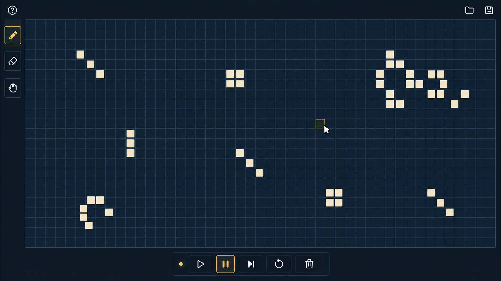

# 0.0.1 版本需求

## 技术约束

基于 libGDX 与 Java 25 开发。

## 元胞自动机的状态

### STT-001 元胞自动机的状态

元胞自动机的状态是一个大小有限的方形网格，每个单元格有 1 和 0 两种状态。

目前网格大小固定为 127 x 127。

## 元胞自动机的显示

### DIS-001 元胞自动机的显示

元胞自动机的状态网格显示在一个有限大小的视窗内，状态为 1 的单元格显示为亮色（比如米黄色），状态为 0 的单元格显示为暗色（比如深蓝色）。

### DIS-002 元胞自动机的视窗拖动

玩家可以按住元胞自动机的视窗进行拖动，拖动时元胞自动机跟随鼠标光标移动。当元胞自动机的某方向边界已经显示时，相反方向的拖动分量失效。

## 元胞自动机的运行

### RUN-001 元胞自动机的状态迁移

为了方便表述，定义一个单元格的“周围单元格”为与其在水平、竖直、对角方向上相邻的所有单元格：
- 对于非网格边界的单元格，周围单元格有 8 个。
- 对于网格边界上的单元格，周围单元格不足 8 个。

一个元胞自动机从一个状态迁移到下一个状态时，遵循以下规则：
- 对于当前状态网格中的每一个单元格，如果它的状态是 0，且周围单元格中恰好有 3 格状态为 1，那么下一个状态中该格的状态变为 1。
- 对于当前状态网格中的每一个单元格，如果它的状态是 1，且周围单元格中状态为 1 的单元格数量不为 2 或 3，那么下一个状态中该格的状态变为 0。
- 其余情况下，单元格的状态在下一个状态中不变。

### RUN-002 元胞自动机的步进

玩家点击“步进”按钮时，根据元胞自动机的当前状态，计算其下一个状态，然后用新状态覆盖旧状态呈现给玩家。

### RUN-003 元胞自动机的运行与停止

玩家按下“运行”按钮时，元胞自动机每隔 500ms 自动步进一次，直到玩家按下“暂停”、“重置”或“清空”按钮。在此期间，“运行”、“步进”按钮下陷（不再能按）。

玩家按下“暂停”按钮时，元胞自动机保持在此时的状态。玩家按下“重置”按钮时，元胞自动机退回到玩家上次编辑的状态。玩家按下“清空”按钮时，元胞自动机将状态设置为空网格。

## 元胞自动机的编辑

### EDT-001 元胞自动机的编辑模式

在元胞自动机没有在运行时，元胞自动机处于编辑模式，可被编辑。步进由于可立刻完成，故视作处于编辑模式。运行模式或编辑模式通过模式指示物体现。

### EDT-002 编辑单元格

在编辑模式下，玩家点击视窗中元胞自动机的单元格，可以将该单元格的状态改变（1 变 0，0 变 1）。

### EDT-003 元胞自动机的清空

在编辑模式下，玩家按下“清空”按钮时，元胞自动机的所有单元格状态均置为 0。

## 艺术风格

### DES-001 画面风格

画面尽量用简约图形引导玩家，尽量不包含文字。

配色以深色为主，以体现实验室氛围、科技感。

大致参考图：

实现时应当消除图中多余的组件、未对齐的方格。
